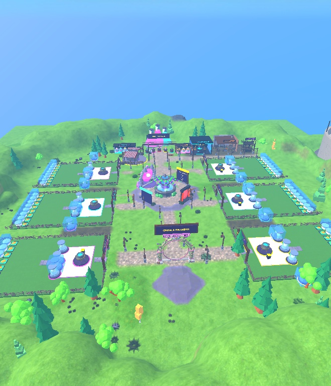
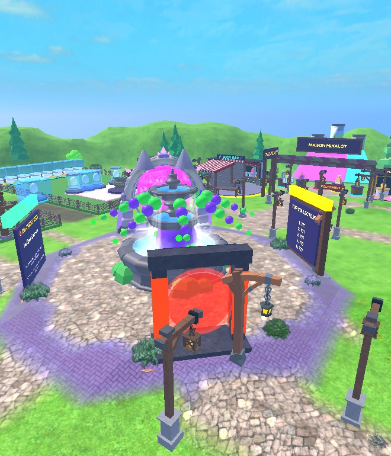
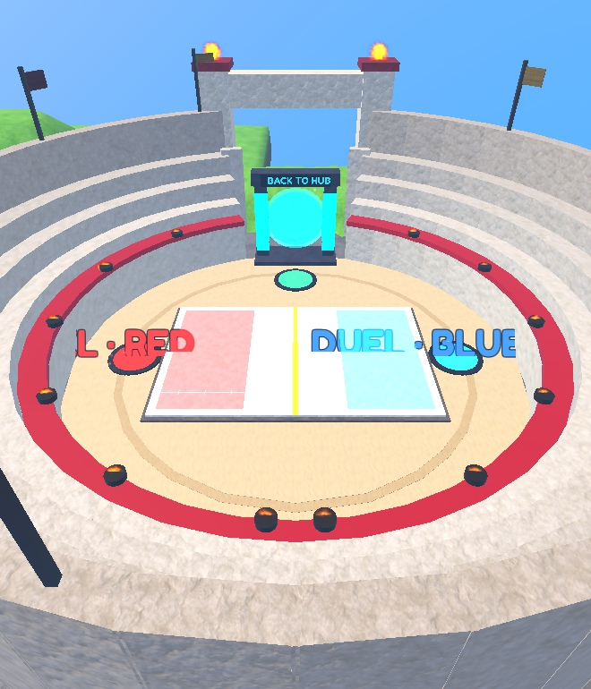
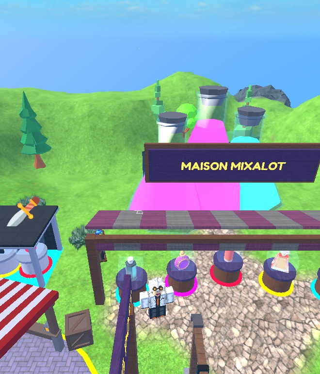
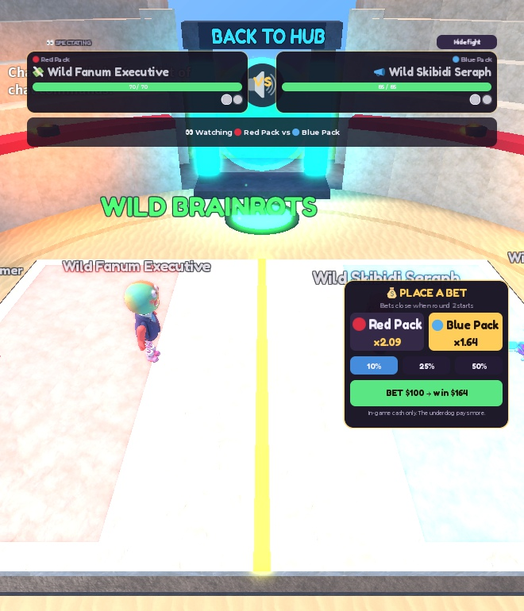
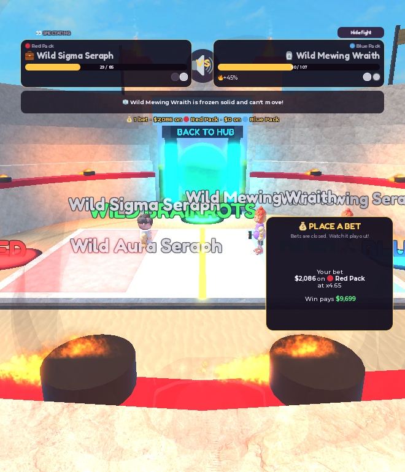

<div align="center">


# 🧪 Grow a Brainrot

**Brew wild potions, grow goofy brainrot creatures from mixed-up body parts, battle them in the Colosseum, and trade with friends.**

[](https://www.roblox.com/games/109448329924596)
[](https://luau.org/)
[]()
[](https://rojo.space/)
[]()
[](LICENSE)
[](https://www.roblox.com/games/109448329924596)

</div>

---

## 📸 Screenshots

| The World | The Hub |
|---|---|
|  |  |

| The Colosseum | Potion Market |
|---|---|
|  |  |

| Battle | Betting |
|---|---|
|  |  |

---

## 🎮 About

**Grow a Brainrot** is a creature-collecting simulator built in **Roblox Studio** with **Luau**. Every player owns a lab plot. Buy elixirs at the market, brew them in your cauldron, and hatch capsules that drop creature parts: a **Head**, **Torso**, **Arms**, **Legs** and a **Weapon**. Snap parts together at the Assembly Lab to build your own brainrot. Every mix of families and rarities makes a different creature, with its own look, name, stats and income.

Your creatures earn cash on pedestals in your yard. Spend it on bigger labs, rarer elixirs, decorations, growth potions and wings, then take your team to the **Ohio Colosseum** for turn-based battles with a timing bar. Everyone else can watch from the stands and bet in-game cash on the winner.

## ✨ Features

| | |
|---|---|
| 🧪 | **8 potion families**: Sigma, Ohio, Skibidi, Rizz, Fanum, Mewing, Aura, Delulu, each with its own color, perks and part designs |
| | Brew 2+ elixirs into a capsule, then wait for it to hatch in your incubator pods |
|| **5 part slots** (Head, Torso, Arms, Legs, Weapon) and **6 rarities** from Common to Mythic, plus 5% shiny parts |
|| 3D-modeled parts for every family. Legendary and Mythic heads get special models, like the flaming skull |
|| Living creatures: they breathe, bob, wobble their heads, waddle when they walk, lunge in battle and flinch when hit |
|| Family effects that come off every creature (icy sparkles, void smoke, embers, bubbles, halos), plus real fire on the flaming skull |
|| Sing-song brainrot names built from the head and torso, like *Gnam Gnam Dripperoni* or *Fuoco Fuoco Mascellone* |
| 💰 | Cash pedestals in your yard that fill up over time. Step on a pad to collect |
|| Yard decor shop with free placement, plus VIP-only decorations |
| Lab upgrades: extra pods and an auto-stirrer. **Rebirth** for a permanent cash multiplier |
| Growth Potions (+20% size, +35% cash per level), Legendary Wings, and creature naming with a chat filter |
|| **Turn-based battles with a timing bar** (PERFECT / GREAT / GOOD) against wild brainrots, in duels, or in a ranked queue |
|| Show matches while the arena is idle, with live odds and in-game cash bets from the stands |
|| Two-player trading of creatures, parts and cash, where both players must ready up |
|| Robux game passes and developer products, plus a 7-day daily reward streak |
|| Calm looping background music |
|| Progress saved with DataStoreService |
|| UI that scales down for phones and tablets |

## 🕹️ Controls

| Action | PC | Phone / Tablet |
|---|---|---|
| Move | `W` `A` `S` `D` | Thumbstick |
| Jump | `Space` | Jump button |
| Use a station (buy, brew, open, build) | Hold `E` | Tap the prompt |
| Menus (inventory, shop, trade) | Click the side buttons | Tap the side buttons |
| Battle timing | Click when the marker hits the zone | Tap |

## 🧰 Built With

- **Engine:** Roblox Studio
- **Language:** Luau
- **Services:** DataStoreService, MarketplaceService, TextService, ProximityPromptService, TweenService
- **Project layout:** [Rojo](https://rojo.space/)-compatible (`default.project.json`)
- **Art:** 3D-generated creature meshes, custom potion and icon art

## 📂 Project Structure

```
GrowABrainrot/
├── src/
│   ├── server/          # ServerScriptService: game rules, saving, battles, trading, shop
│   ├── client/          # StarterPlayerScripts: HUD, menus, battle UI, music
│   └── shared/          # ReplicatedStorage: config, creature builder, shared logic
├── place/
│   └── GrowABrainrot.rbxl   # The full place: map, models, meshes and UI
├── assets/
│   ├── icon/            # Game icon (512×512)
│   ├── art/             # Key art, mascot, cauldron, potion lineup
│   └── potions/         # Elixir bottle icons used in the shop
├── screenshots/
├── docs/
│   └── LAUNCH_CHECKLIST.md
└── default.project.json
```

### Core Scripts

| Script | Responsibility |
|---|---|
| `server/GameManager.server.luau` | Plots, elixir market, brewing, capsules, assembly, selling, rebirth, wild fights, duels, request routing |
| `server/DataService.luau` | Loading and saving player data with DataStoreService |
| `server/LabAPI.luau` | Shared server API that the other systems plug their requests into |
| `server/BattleSystem.server.luau` | Turn-based battles, timing taps, show matches, betting and the bets board |
| `server/TradeSystem.server.luau` | Two-player trade sessions with offers, cash, ready and confirm |
| `server/Monetization.server.luau` | Game passes, developer products, receipts and daily rewards |
| `server/Showcase.server.luau` | Creature pedestals and cash piles in each yard |
| `server/PlotDecor.server.luau` | Buying, placing, moving and selling yard decor |
| `server/LabUpgrades.server.luau` | Extra incubator pods and the auto-stirrer |
| `server/Wings.server.luau` / `Naming.server.luau` | Legendary Wings and creature naming |
| `shared/Config.luau` | Every number in the game: prices, rarities, odds, income, battle stats |
| `shared/CreatureBuilder.luau` | Builds a creature model from its parts, using the 3D meshes |
| `shared/BattleMoves.luau` | Move list and timing-bar grades |
| `shared/ShopConfig.luau` | Robux item list with IDs and prices |
| `client/LabClient.client.luau` | Main HUD, inventory, creature cards, guide arrow and reveal moments |
| `client/BattleClient.client.luau` | Battle HUD, move picker, timing bar, spectator camera and bet panel |
| `client/CreatureAnimator.client.luau` | Rigs every creature with joints on the client and drives its idle, walk, lunge and hit motion plus family effects |

## 🚀 Getting Started

1. Install **Roblox Studio**.
2. Clone the repo:
   ```bash
   git clone https://github.com/Holmes-99/GrowABrainrot.git
   ```
3. Open `place/GrowABrainrot.rbxl` in Studio and press ▶️ **Play**.

### Syncing the code with Rojo (optional)

The scripts in `src/` are the source of truth. To push them into the place:

1. Install [Rojo](https://rojo.space/docs/v7/getting-started/installation/) and its Studio plugin.
2. Run `rojo serve` in the repo folder.
3. In Studio, open the Rojo plugin and click **Connect**.

Everything else in the place (the map, models and meshes) stays untouched, because every service in `default.project.json` uses `$ignoreUnknownInstances`.

> **Note:** saving needs **Game Settings → Security → Enable Studio Access to API Services** on a published place.

## 🗺️ Roadmap

- [x] Brewing, capsules and creature assembly
- [x] 3D parts for all 8 families
- [x] Turn-based battles, show matches and betting
- [x] Player trading
- [x] Robux shop and daily rewards
- [x] Published on Roblox
- [x] Animated creatures: idle motion, attack moves and family effects (fire, sparkles, smoke)
- [x] Brainrot-style creature names
- [ ] More parts and creature families
- [ ] Weekend events and limited parts
- [ ] Open to all ages

## 📄 License

This project is licensed under the MIT License. See the [LICENSE](LICENSE) file for details. Music tracks are licensed through the Roblox audio library and are not covered by this license.

---

<div align="center">

Made with 🧪 and Luau by [Holmes-99](https://github.com/Holmes-99)

</div>
